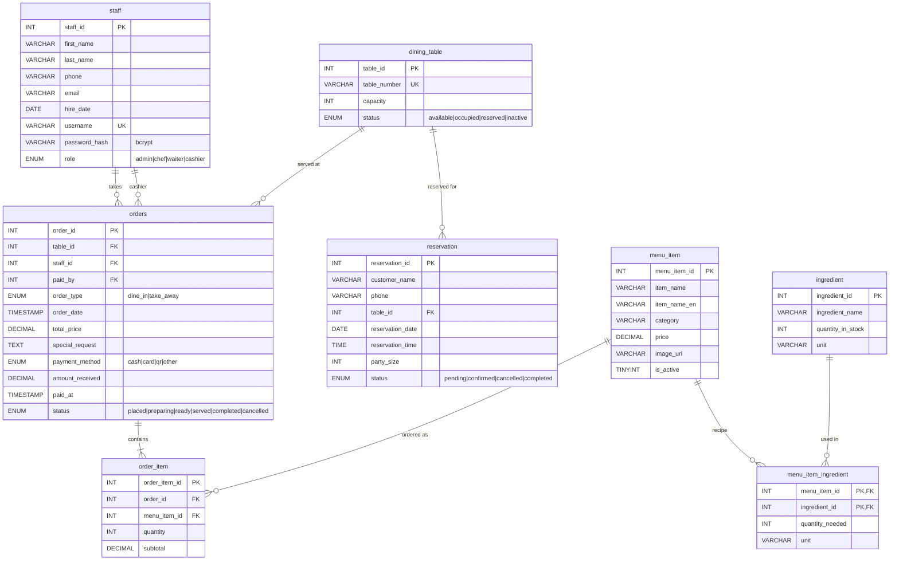

# ER Diagram — Restaurant Order Management System

สร้างจาก `database/schema.sql` (ตรงกับฐานข้อมูลจริงทุกตารางและทุก FK) · รูปภาพ: [er-diagram.png](er-diagram.png)

- **8 entities**, **7 relationships** (8 foreign keys — ความสัมพันธ์ M:N นับเป็น 1)
- `PK` = primary key, `FK` = foreign key, `UK` = unique

## Relationships

| # | Relationship | Cardinality | FK | On delete |
|---|---|---|---|---|
| 1 | staff — orders (สั่งแทนลูกค้า) | 1 : 0..N | `orders.staff_id` | SET NULL |
| 2 | staff — orders (รับชำระเงิน) | 1 : 0..N | `orders.paid_by` | SET NULL |
| 3 | dining_table — reservation | 1 : 0..N | `reservation.table_id` | CASCADE |
| 4 | dining_table — orders | 1 : 0..N | `orders.table_id` | RESTRICT |
| 5 | orders — order_item | 1 : 1..N | `order_item.order_id` | CASCADE |
| 6 | menu_item — order_item | 1 : 0..N | `order_item.menu_item_id` | RESTRICT |
| 7 | menu_item — ingredient (M:N ผ่าน `menu_item_ingredient`) | M : N | `menu_item_ingredient.menu_item_id`, `.ingredient_id` | CASCADE |

- `menu_item_ingredient` เป็นตารางเชื่อม (bridge) ของความสัมพันธ์ M:N ระหว่างเมนูกับวัตถุดิบ PK เป็น composite key `(menu_item_id, ingredient_id)`
- `order_item` ก็เป็นตารางเชื่อม M:N ระหว่างออเดอร์กับเมนู แต่มี PK ของตัวเอง เพราะเก็บ `subtotal` ณ เวลาที่สั่ง (ราคาเมนูเปลี่ยนทีหลัง บิลเก่าไม่เปลี่ยน)

## ทำไมเหลือ 8 ตาราง (ลดจาก 11)

| เดิม | ตอนนี้ | เหตุผล |
|---|---|---|
| `employee` + `sys_user` (1:1) | `staff` | พนักงานทุกคนต้อง login เข้าระบบ แยกสองตารางไม่ได้ประโยชน์ |
| `customer` | `reservation.customer_name`, `reservation.phone` | ร้านไม่มีระบบสมาชิก ชื่อและเบอร์เป็นข้อมูลติดต่อของการจองครั้งนั้น |
| `table_session` | ลบ | QR ประจำโต๊ะ (`/?table=2`) ใช้แค่ `dining_table` ก็พอ |
