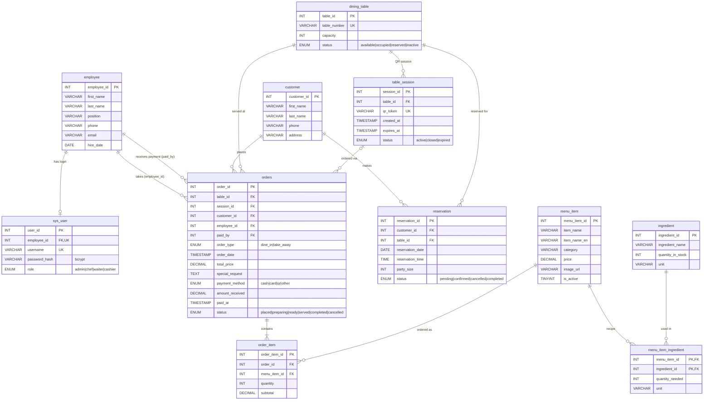

# ER Diagram — Restaurant Order Management System

สร้างจาก `database/schema.sql` (ตรงกับฐานข้อมูลจริงทุกตารางและทุก FK) · รูปภาพ: [er-diagram.png](er-diagram.png)

- **11 entities**, **12 relationships** (13 foreign keys — ความสัมพันธ์ M:N นับเป็น 1)
- `PK` = primary key, `FK` = foreign key, `UK` = unique

## Relationships

| # | Relationship | Cardinality | FK | On delete |
|---|---|---|---|---|
| 1 | employee — sys_user | 1 : 0..1 | `sys_user.employee_id` (UNIQUE) | CASCADE |
| 2 | employee — orders (สั่งแทนลูกค้า) | 1 : 0..N | `orders.employee_id` | SET NULL |
| 3 | employee — orders (รับชำระเงิน) | 1 : 0..N | `orders.paid_by` | SET NULL |
| 4 | customer — orders | 1 : 0..N | `orders.customer_id` | SET NULL |
| 5 | customer — reservation | 1 : 0..N | `reservation.customer_id` | CASCADE |
| 6 | dining_table — reservation | 1 : 0..N | `reservation.table_id` | CASCADE |
| 7 | dining_table — table_session | 1 : 0..N | `table_session.table_id` | CASCADE |
| 8 | dining_table — orders | 1 : 0..N | `orders.table_id` | RESTRICT |
| 9 | table_session — orders | 0..1 : 0..N | `orders.session_id` | SET NULL |
| 10 | orders — order_item | 1 : 1..N | `order_item.order_id` | CASCADE |
| 11 | menu_item — order_item | 1 : 0..N | `order_item.menu_item_id` | RESTRICT |
| 12 | menu_item — ingredient (M:N ผ่าน `menu_item_ingredient`) | M : N | `menu_item_ingredient.menu_item_id`, `.ingredient_id` | CASCADE |

`menu_item_ingredient` เป็นตารางเชื่อม (bridge) ของความสัมพันธ์ M:N ระหว่างเมนูกับวัตถุดิบ PK เป็น composite key `(menu_item_id, ingredient_id)`
